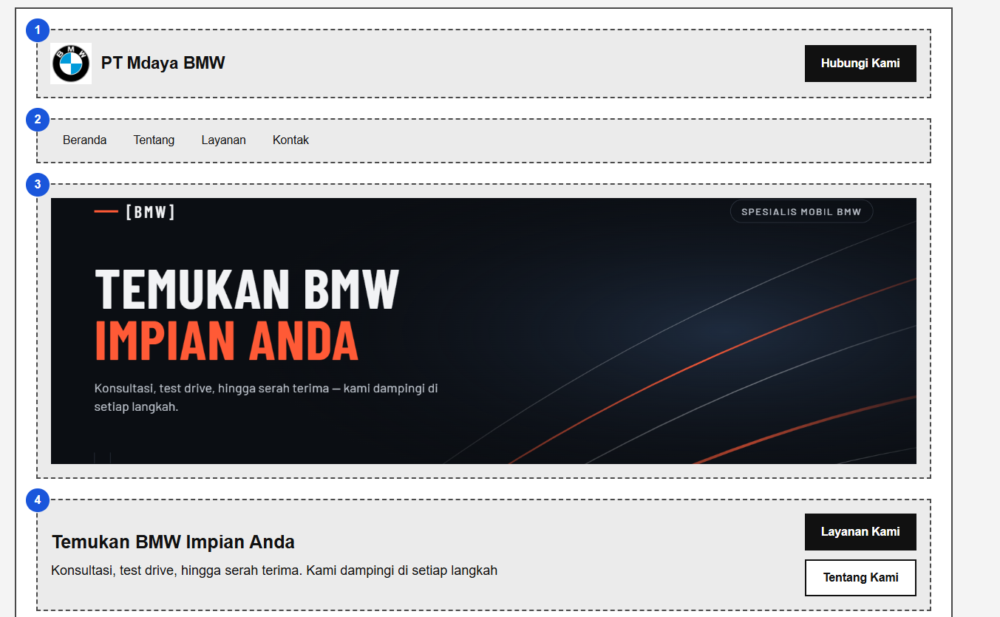
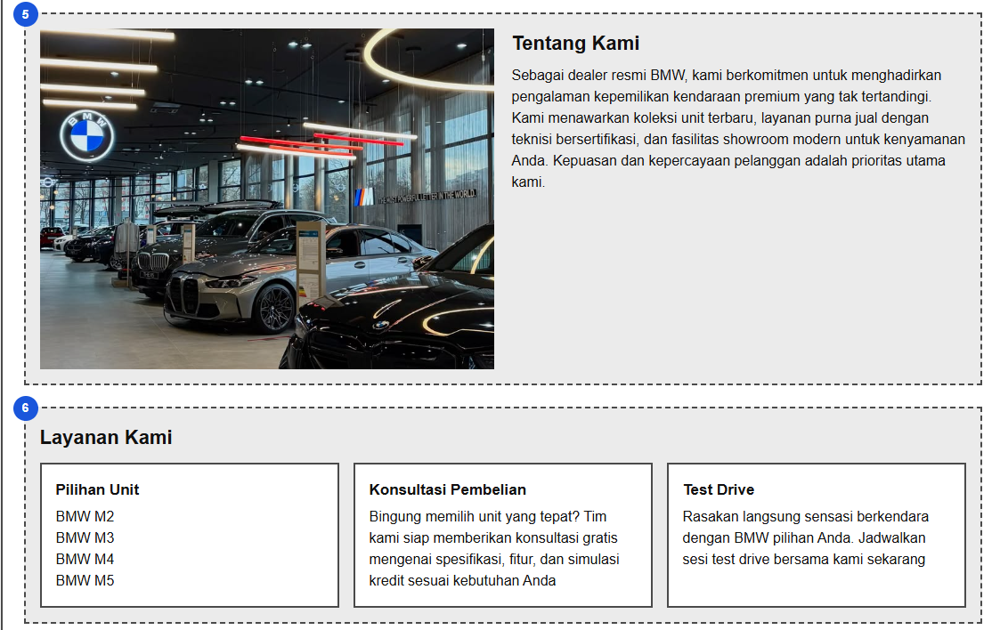
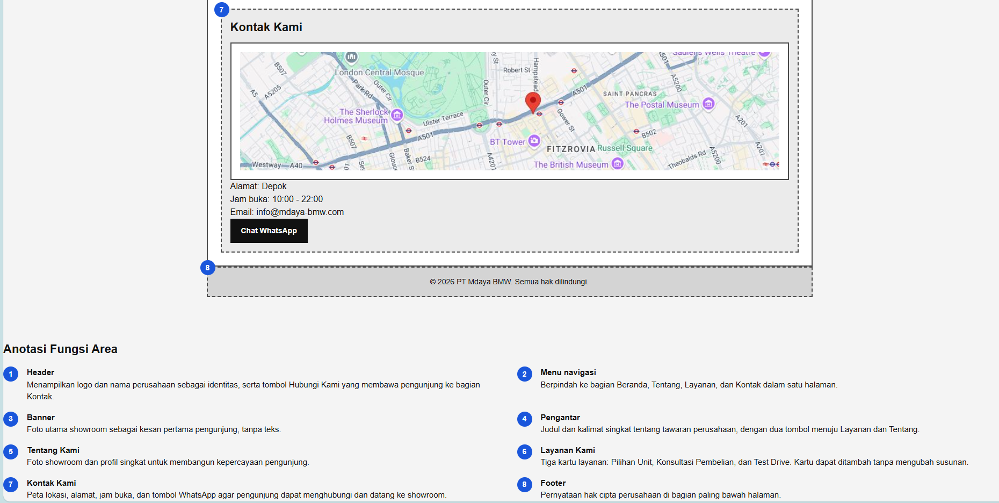
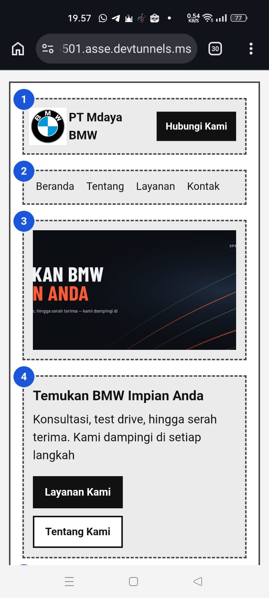
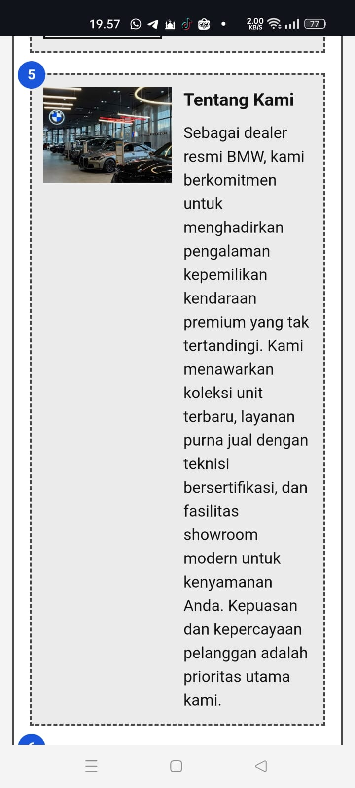
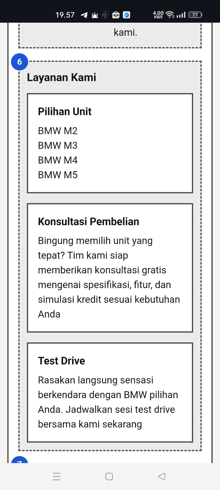
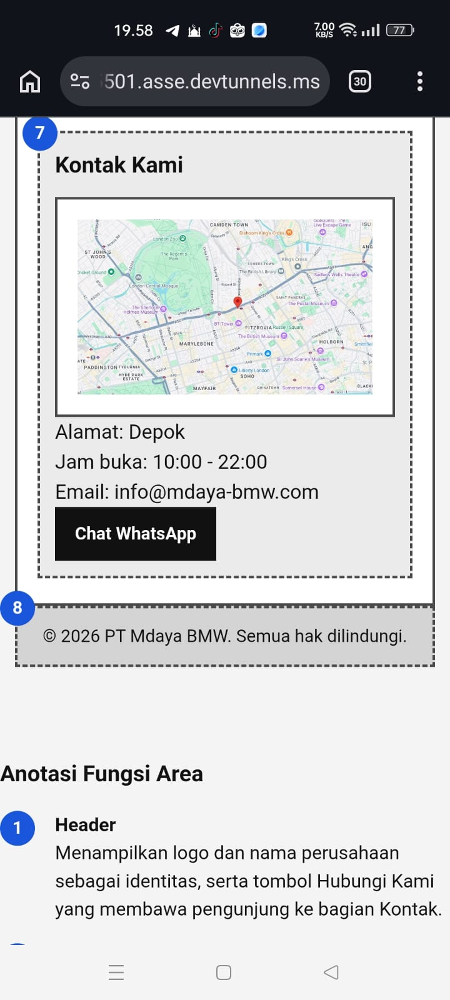
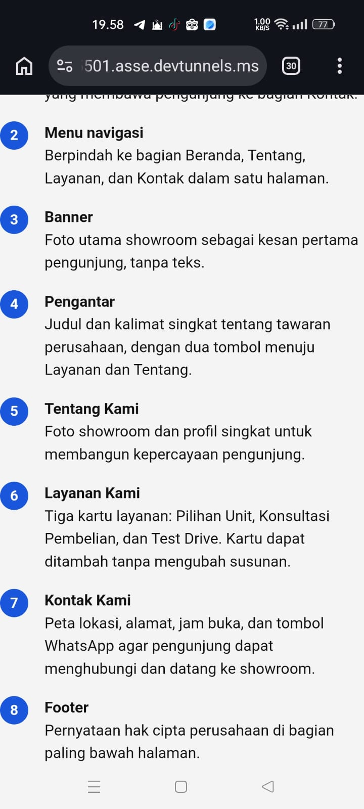

# Tugas Pertemuan 5 - Wireframe Company Profile

## Biodata Mahasiswa

|               |                                       |
| ------------- | ------------------------------------- |
| Nama          | Muhammad Syamil                       |
| NIM           | (4525210130)                          |
| Program Studi | Teknik Informatika                    |
| Universitas   | Universitas Pancasila                 |
| Mata Kuliah   | Desain Web                            |
| Kelas         | A                                     |
| Pertemuan     | 5 - Struktur UI/UX dan Layout Website |

## Deskripsi Tugas

**Studi kasus.** Sebuah tim akan membuat portal berita, toko online, atau company profile. Sebelum coding, klien sering mengubah susunan konten. Mahasiswa diminta membuat wireframe agar perubahan struktur dapat disepakati dengan biaya rendah sebelum desain high fidelity dan implementasi.

**Perintah.** Pilih salah satu: portal berita, toko online, atau company profile. Buat wireframe desktop dan mobile lengkap dengan anotasi fungsi setiap area.

**Pilihan saya.** Company profile (PT Mdaya BMW), memakai navbar tanpa sidebar.

**Bukti yang dikumpulkan.**

- Source code/folder project (`index.html`, `css/style.css`, `images/`)
- Screenshot hasil pada desktop dan mobile
- Ringkasan 150-250 kata mengenai perubahan, masalah, dan solusi
- Catatan pembagian peran untuk tugas kelompok

## Hasil Screenshot

### Desktop








### Mobile












## Anotasi Fungsi Area

| No | Area          | Fungsi                                                                                                              |
| -- | ------------- | ------------------------------------------------------------------------------------------------------------------- |
| 1  | Header        | Menampilkan logo dan nama perusahaan sebagai identitas, serta tombol Hubungi Kami menuju bagian Kontak              |
| 2  | Menu navigasi | Berpindah ke bagian Beranda, Tentang, Layanan, dan Kontak dalam satu halaman                                        |
| 3  | Banner        | Foto utama showroom sebagai kesan pertama pengunjung, tanpa teks                                                    |
| 4  | Pengantar     | Judul dan kalimat singkat tentang tawaran perusahaan, dengan dua tombol menuju Layanan dan Tentang                  |
| 5  | Tentang Kami  | Foto showroom dan profil singkat untuk membangun kepercayaan pengunjung                                             |
| 6  | Layanan Kami  | Tiga kartu layanan: Pilihan Unit, Konsultasi Pembelian, dan Test Drive; kartu dapat ditambah tanpa mengubah susunan |
| 7  | Kontak Kami   | Peta lokasi, alamat, jam buka, dan tombol WhatsApp agar pengunjung dapat menghubungi dan datang ke showroom         |
| 8  | Footer        | Pernyataan hak cipta perusahaan di bagian paling bawah halaman                                                      |

## Struktur Folder

```text
tugas-pertemuan-5/
├── index.html        isi wireframe dan daftar anotasi
├── css/
│   └── style.css     tampilan wireframe (desktop dan mobile)
├── images/           screenshot desktop1-4 dan mobile1-4
└── README.md         laporan tugas ini
```

## Penjelasan / Ringkasan (190 kata)

Tugas ini membuat wireframe company profile untuk PT Mdaya BMW, showroom mobil BMW, dalam tampilan desktop dan mobile. Wireframe ditulis dengan HTML dan CSS biasa tanpa JavaScript, memakai elemen semantik header, nav, main, section, dan footer, dengan satu h1 serta beberapa h2 dan h3. Tempat foto dan peta ditampilkan sebagai kotak abu-abu bersilang, sedangkan warna merek dan foto asli sengaja ditunda ke tahap desain high fidelity. Masalah utamanya adalah klien sering mengubah susunan konten setelah pengerjaan berjalan, sehingga struktur perlu disepakati lebih dulu dengan biaya rendah.

