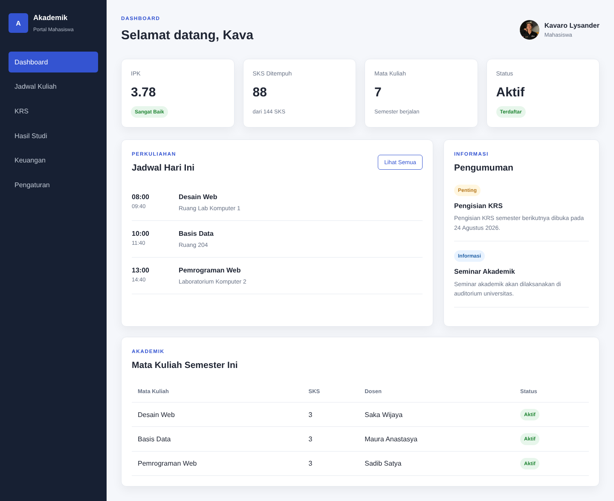
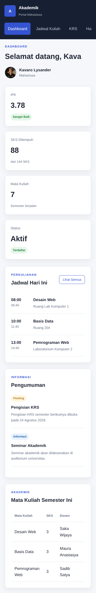
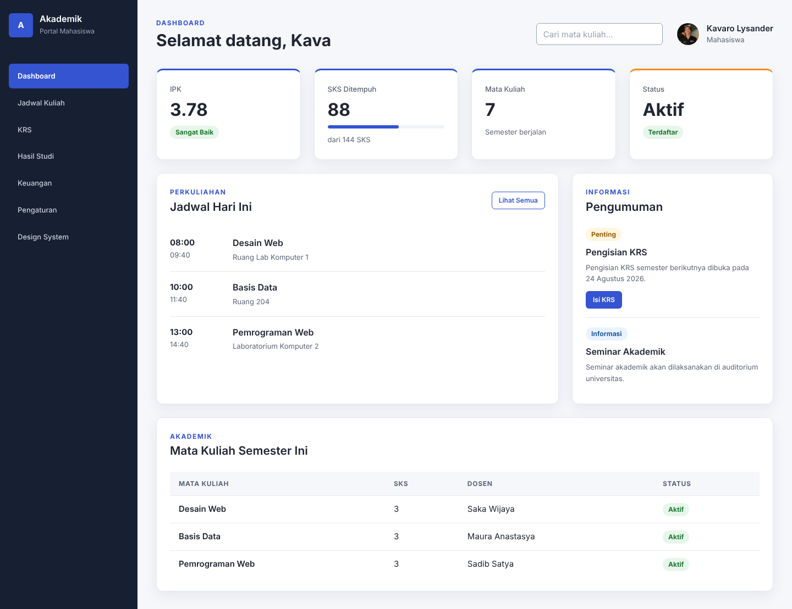
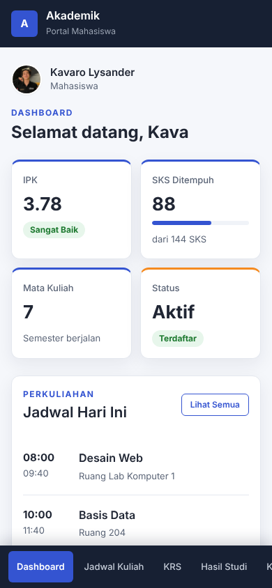
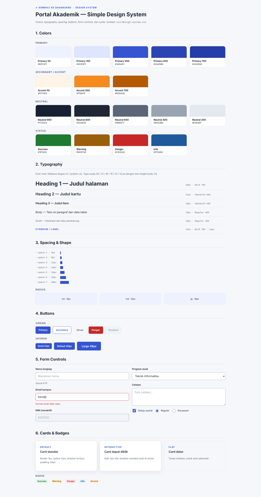
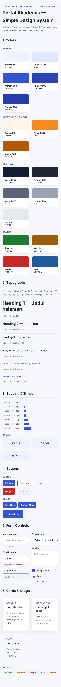

# **Tugas Pertemuan 6 - Simple Design System & Dashboard Mahasiswa**

## Biodata Mahasiswa

|               |                                                    |
| ------------- | -------------------------------------------------- |
| Nama          | Muhammad Syamil                                    |
| NIM           | _(4525210130)_                                        |
| Program Studi | _(Teknik Informatika)_                              |
| Mata Kuliah   | Desain Web                                         |
| Kelas         | _(A - Lab AI )_                                      |
| Pertemuan     | 6 - Mockup, Visual Hierarchy, Warna, dan Tipografi |

## Deskripsi Tugas

**Dasar pengerjaan.** Mengembangkan kode contoh **`Contoh2`** yang berisi dashboard mahasiswa menggunakan HTML dan CSS. Struktur utamanya dipertahankan (navigasi, ringkasan akademik, jadwal, pengumuman, dan tabel mata kuliah), lalu visualnya dikembangkan memakai Simple Design System. Seluruh implementasi menggunakan HTML5 dan CSS murni, tanpa framework atau JavaScript.

**Ketentuan.** Design System mencakup colors, typography, spacing, buttons, form controls, dan cards. Mockup memakai color palette, type scale, button style, card style, serta layout responsif untuk desktop dan mobile.

## Struktur Folder

```text
Pertemuan6/
├
└── Tugas/
    ├── css/
    │   ├── design-system.css        (token + komponen design system)
    │   ├── style.css                (layout dashboard)
    │   └── style_sebelum.css        (CSS awal, untuk pembanding)
    ├── DesignSystem/
    │   ├── design-system-desktop.png
    │   └── design-system-mobile.png
    ├── images/
    │   ├── after-desktop.png
    │   ├── after-mobile.png
    │   ├── before-desktop.png
    │   ├── before-mobile.png
    │   └── Profile.jpe
    ├── design-system.html           (halaman dokumentasi design system)
    ├── index.html                   (dashboard sesudah perubahan)
    ├── index_sebelum.html           (dashboard sebelum perubahan)
    └── README.md
```

## Hasil Screenshot

### Sebelum Perubahan

**Desktop**



**Mobile**



### Sesudah Perubahan

**Desktop**



**Mobile**



## Design System - Tampilan Dokumentasi

Halaman dokumentasi menampilkan swatch warna, type scale, skala spacing, variasi tombol, form controls, serta contoh cards.

**Desktop**



**Mobile**



## Simple Design System

| Bagian | Aturan yang digunakan |
| --- | --- |
| Colors | Primary `#3454D1`, accent/secondary `#F58A1F`, neutral (`#172033` sampai `#F5F7FB`), serta status success, warning, danger, dan info. |
| Typography | Font Inter dengan fallback Segoe UI/system-ui. Type scale 30, 21, 16, 15, 13, dan 12px dengan bobot bold/semibold/regular. Line-height heading 1.25 dan body 1.6. |
| Spacing | Skala berbasis 4px: 4, 8, 12, 16, 24, 32, dan 48px. |
| Buttons | Primary, secondary, ghost, danger, dan disabled; ukuran 32, 40, dan 48px, radius konsisten, serta hover/focus state. |
| Form controls | Input, search, select, textarea, checkbox, radio, label yang terhubung melalui atribut `for`/`id`, state error dan disabled, serta indikator fokus. |
| Cards | Surface putih, border netral, radius 12px, shadow halus, padding seragam, varian interactive dan flat. |

Token warna, tipografi, spacing, radius, dan shadow didefinisikan sebagai CSS custom properties di bagian `:root` pada `css/design-system.css`.

## Ringkasan

Tugas ini mengembangkan dashboard mahasiswa dari source Contoh2 menjadi mockup dengan sistem visual yang konsisten dan responsif. Struktur utama (navigasi, ringkasan akademik, jadwal, pengumuman, dan tabel mata kuliah) dipertahankan supaya fungsi contoh tetap dikenal. Perubahan terbesar terletak pada hierarki visual: judul dan eyebrow memakai skala yang konsisten, angka ringkasan diberi penekanan, sedangkan badge, garis aksen pada kartu, dan progress bar SKS membantu membedakan status dan progres. Warna primary, accent, neutral, serta success, warning, danger, dan info ditetapkan sebagai CSS custom properties di `:root`. Skala tipografi memakai font Inter, sedangkan spacing mengikuti kelipatan 4px. Komponen tombol, form controls, status, dan card memakai class reusable agar tampilan lebih mudah dirawat. Karena dashboard awal tidak memuat form control yang lengkap, dibuat halaman Design System khusus untuk menampilkan button, input, select, textarea, checkbox, radio, kartu, palet warna, tipografi, dan spacing. Masalah layout utama adalah ruang sidebar dan tabel pada layar kecil; solusinya ialah media query yang mengubah sidebar menjadi top bar dengan navigasi di bagian bawah, membuat statistik dua kolom, menumpuk jadwal dan pengumuman, serta mengubah tabel menjadi daftar kartu. Seluruh proyek menggunakan HTML5 dan CSS murni tanpa framework atau JavaScript.

## Detail Perubahan, Masalah, dan Solusi

1. **Warna kurang terarah.** Versi awal memakai nilai warna yang tersebar di stylesheet, termasuk beberapa nilai yang ditulis langsung. Solusinya, warna primer, accent, netral, dan status dijadikan CSS custom properties agar konsisten dan mudah diubah.
2. **Hierarki visual belum kuat.** Judul kartu, data, dan keterangan memiliki penekanan yang relatif serupa dan ukuran font bervariasi tanpa aturan. Solusinya, dipakai type scale tunggal, eyebrow huruf kapital, angka statistik 32px bold, garis aksen pada kartu statistik, dan progress bar untuk progres SKS.
3. **Komponen belum sepenuhnya seragam.** `.stat-card` dan `.panel` memiliki gaya yang diduplikasi, dan hanya ada satu jenis tombol. Solusinya, dibuat class reusable seperti `.card`, `.btn` beserta varian, `.badge`, serta token radius dan spacing.
4. **Tampilan layar sempit berisiko padat.** Sidebar dan tabel empat kolom memakan lebar pada ponsel. Solusinya, media query mengubah menu menjadi bottom navigation, menyusun konten menjadi satu kolom, menjaga kartu statistik dua kolom, dan menampilkan tabel sebagai daftar kartu berlabel (`data-label`).
5. **Form control tidak terlihat pada mockup utama.** Dashboard contoh hanya memakai sedikit form, sehingga ditambahkan kolom pencarian pada header, dan seluruh komponen input, select, textarea, checkbox, serta radio didokumentasikan pada halaman Design System.
6. **Kontras dan fokus kurang jelas.** Teks status pada latar muda kurang tegas dan elemen interaktif tanpa penanda fokus. Solusinya, warna teks status digelapkan dan ditambahkan focus ring pada tombol, input, serta menu.
7. **Teks alt foto profil tidak sesuai.** Alt awal menyebut nama lain. Solusinya, alt diperbaiki menjadi "Foto profil Kavaro Lysander".

## Cara Menjalankan

1. Ekstrak folder proyek.
2. Buka `index.html` menggunakan browser. Versi sebelum perubahan ada pada `index_sebelum.html`.
3. Klik menu **Design System** di sidebar untuk membuka dokumentasi komponen.
4. Untuk memeriksa versi mobile, gunakan Developer Tools browser dan aktifkan device emulation, atau buka halaman pada browser ponsel.

Dokumen ini dibuat oleh &copy; Muhammad Syamil, 2026.
